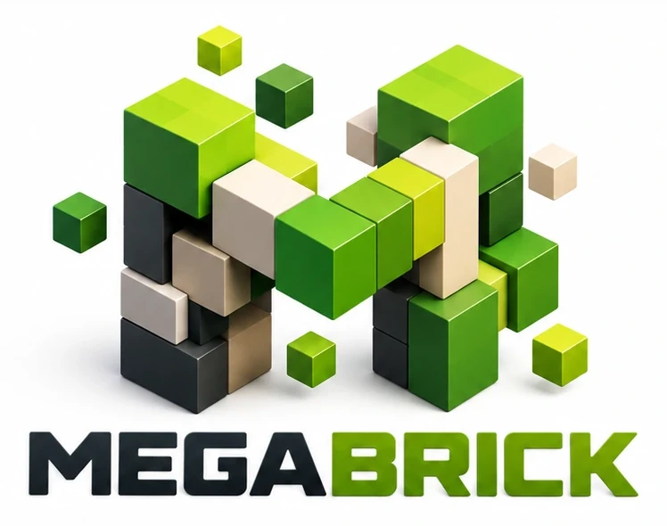

<p align="center">
  <picture>
    <source media="(prefers-color-scheme: dark)" srcset="public/logo/megabrick-oscuro.webp" />
    
  </picture>
</p>

# Megabrick

**Megabrick** es un juego sandbox de bloques en primera persona que corre en el navegador. Recorrés un mundo hecho de cubos, lo explorás y construís bloque a bloque. Todo es original: el nombre, el diseño y las texturas, que se generan por código en pixel art de 16×16.

🎮 **Versión jugable:** https://juanmarcosmoreno-arch.github.io/Kubrik/

> Megabrick se juega en **PC o Mac con teclado y mouse**. Por ahora no está pensado para celulares ni tablets.

## Estado del desarrollo

El juego se construye por etapas. Siempre queda una versión jugable.

| Etapa | Contenido | Estado |
|---|---|---|
| 1 | Base jugable: cámara en primera persona, vuelo, piso de bloques, atlas procedural, FPS | ✅ |
| 2 | Mundo por chunks y terreno procedural infinito | ✅ |
| 3 | Física del jugador: gravedad, salto, colisiones, nado | ✅ |
| 4 | Romper y poner bloques, hotbar, mira | ✅ |
| Extra | Multijugador: jugar en el mismo mundo desde otra computadora con un código | ✅ |
| 5 | Guardado en IndexedDB y menú de mundos | ⏳ |
| 6 | Ciclo día/noche, oclusión ambiental, sonidos, opciones | ⏳ |
| 7 | Rendimiento: Web Workers, cola de chunks priorizada | ⏳ |

## Requisitos

- [Node.js](https://nodejs.org/) 20.19 o más nuevo (recomendado: 22).
- Un navegador de escritorio con WebGL 2: Chrome, Edge, Firefox o Safari.

## Instalación

```bash
git clone https://github.com/juanmarcosmoreno-arch/Kubrik.git
cd Kubrik
npm install
```

## Cómo correrlo

```bash
npm run dev       # servidor de desarrollo con recarga automática
npm run build     # build de producción en la carpeta dist/
npm run preview   # sirve el build de producción para probarlo
```

`npm run dev` muestra en la consola la dirección para abrir el juego, por ejemplo `http://localhost:5173/megabrick/`.

### Semilla y distancia de render

Por ahora se eligen en la dirección del juego. El menú de mundos llega en la etapa 5 y el de opciones en la 6.

- `?semilla=lo-que-quieras`: la misma semilla genera siempre el mismo mundo. Acepta texto o un número. Sin este parámetro se usa `megabrick`.
- `?distancia=8`: distancia de render en chunks, de 2 a 16. Por defecto es 6.

Ejemplo: `http://localhost:5173/megabrick/?semilla=islas&distancia=8`.

## Controles

| Tecla | Acción |
|---|---|
| Clic en **Jugar** | Empezar a jugar (captura el mouse) |
| Clic en **Continuar** o en cualquier parte (en pausa) | Volver al juego |
| **W A S D** | Moverse |
| **Mouse** | Mirar |
| **Espacio** | Saltar (mantenido, salta cada vez que toca el piso). En el agua: nadar hacia arriba |
| **Ctrl** (o doble toque de **W**) | Correr: más rápido y con la vista un poco más abierta |
| **F** | Activar o desactivar el vuelo |
| **Espacio / Shift** (volando) | Subir / bajar |
| **Clic izquierdo** | Romper el bloque apuntado (mantenido, sigue rompiendo) |
| **Clic derecho** | Poner el bloque elegido en la cara apuntada |
| **1 – 9** o **rueda del mouse** | Elegir casilla de la hotbar |
| **V** | Cambiar la cámara: primera persona → tercera persona → de frente |
| **Esc** | Soltar el mouse y pausar |

### Física

- El jugador mide 1,8 bloques de alto y 0,6 de ancho, y choca contra los bloques. Su caja de colisión se mueve eje por eje y en pasos cortos, así que no atraviesa nada aunque caiga muy rápido.
- Hay gravedad. El salto alcanza unos 1,25 bloques: un escalón de un bloque se sube saltando y dos bloques ya no.
- En el agua te hundís despacio y nadás hacia arriba con Espacio. Para salir, nadá contra la orilla manteniendo Espacio. Con los ojos bajo el agua todo se ve azul.
- Volando no hay gravedad: Espacio sube y Shift baja.

> **Ctrl+W:** en el navegador, Ctrl+W cierra la pestaña y ninguna página puede impedirlo. Mientras jugás, Megabrick pide confirmación antes de cerrar. Si querés evitarlo del todo, corré con doble toque de W.

### Construir

- **Bloque apuntado:** la mira del centro marca el bloque al que apuntás, con un contorno, hasta 6 bloques de distancia. El cálculo es un raycast voxel con el algoritmo DDA, que no saltea ningún bloque. El agua se atraviesa con la mirada.
- **Romper y poner:** clic izquierdo rompe el bloque, salvo el lecho primordial, que es indestructible. Clic derecho pone el bloque elegido sobre la cara apuntada, pero nunca dentro del jugador. Manteniendo el botón, se repite cada cuarto de segundo.
- **Hotbar:** tiene 9 casillas abajo de la pantalla: césped, tierra, piedra, tablones, ladrillo de piedra, vidrio, tronco, follaje y arena. El bloque elegido se ve en la mano, en primera persona y también en el personaje en tercera persona.
- **Mallas:** al cambiar un bloque se rearma enseguida solo la malla de su chunk, y la del chunk vecino si el bloque está en el borde.
- **Agua:** si rompés un bloque con agua arriba o a un costado, el hueco se llena de agua. Por ahora el agua no fluye.
- **Tus cambios se recuerdan:** se guardan como diferencias respecto del terreno generado. Si te alejás y el chunk se descarga, al volver tu construcción sigue ahí. Hasta la etapa 5, que agrega el guardado, se pierden al recargar la página. Ese registro es lo que se guarda en la etapa 5 y lo que se comparte en el multijugador.
- **Mira:** en primera persona y en tercera desde atrás marca el bloque apuntado. En la vista de frente se oculta.

## Multijugador

Podés jugar en el mismo mundo con amigos, cada uno desde su computadora:

1. Una persona toca **Multijugador → Crear partida** y recibe un código, por ejemplo `K7Q-X2M`. Puede copiarlo y mandarlo por cualquier chat. El botón **Multijugador** está en la pantalla de inicio y también en la pausa: así se puede invitar a alguien a un mundo en el que ya se viene jugando.
2. Las demás tocan **Multijugador**, escriben el código en **Unirse** y entran a jugar. Reciben el mundo de quien creó la partida: misma semilla y mismos bloques cambiados. Aparecen al lado de quien la creó. Ese mundo reemplaza al propio: si ya habían construido algo, el juego pregunta antes, porque se pierde (el guardado llega en la etapa 5).
3. Cada uno ve a los demás con su personaje, su color y su nombre arriba de la cabeza. Arriba a la derecha está la lista de jugadores. En la pausa están el código y el botón para copiarlo.
4. Lo que rompe o pone cualquiera aparece en las computadoras de todos.
5. **Salir de la partida** (en el panel de Multijugador) corta la conexión y deja seguir jugando solo en el mismo mundo. Cerrar el panel mientras se está conectando cancela la conexión.

**Cómo funciona.**
- **Conexión:** las computadoras se conectan directo entre sí con WebRTC. Para el primer contacto, que es intercambiar el código, se usa el servidor público y gratuito de [PeerJS](https://peerjs.com/), así que no hace falta un servidor propio y funciona desde GitHub Pages.
- **Qué viaja por la red:** el terreno no. Cada computadora lo genera con la semilla, y solo viajan las posiciones y los cambios de bloques.
- **El anfitrión:** quien crea la partida ordena los cambios para que todos terminen viendo el mismo mundo. También revisa todo lo que mandan los demás, porque un jugador podría usar una versión modificada del juego. No acepta bloques inválidos, ni romper o poner lecho primordial, ni cambios lejos de donde está el jugador. Aplica como mucho 30 cambios por segundo por jugador (con ráfagas de hasta 60). Los que sobran esperan en fila y, si son demasiados, se rechazan y se le devuelve el bloque real a quien los hizo. Las posiciones de más de 30 por segundo se descartan. Los mensajes viajan en formato MsgPack, que no se puede usar para colgar la pestaña de otro con un mensaje armado a propósito.

**Límites.**
- La partida dura mientras quien la creó tenga el juego abierto. Si se va, los demás siguen jugando solos en ese mundo.
- Admite hasta 6 jugadores.
- En algunas redes muy cerradas, como empresas o colegios, la conexión directa puede fallar. PeerJS incluye servidores de respaldo (TURN) que ayudan en muchos casos.
- Para usar otro servidor de PeerJS, uno propio o uno local para probar con `npx peer --port 9000`, agregá `?servidor=host:puerto` a la dirección, en todas las computadoras. Sin protocolo se usa el de la página: desde GitHub Pages (https) el servidor tiene que tener https. Para uno local sin https, escribilo con el protocolo: `?servidor=http://localhost:9000`.

## El mundo

El mundo es infinito y se genera a medida que te movés, en chunks de 16 × 16 bloques de base y 128 de alto.

- **Terreno:** sale de ruido simplex con varias octavas, que arma llanuras, colinas y algunas montañas. Las cimas muy altas son de piedra.
- **Capas:** césped arriba, 3 o 4 de tierra, piedra debajo y lecho primordial indestructible en y = 0.
- **Agua:** el mar está a una altura fija (y = 40) y es semitransparente. Hay arena en costas y fondos poco profundos.
- **Árboles:** se agrupan en bosques y también aparecen sueltos. Sus copas pasan de un chunk a otro sin cortarse.
- **Minerales:** cobrizo, azurita y solarita aparecen en vetas dentro de la piedra. Cuanto más raro el mineral, más hondo.
- **Carga de chunks:** se generan y mallan primero los más cercanos al jugador, con un tope de tiempo por frame para no trabar el juego. Los lejanos se liberan de la memoria.
- **Niebla:** tiene el color del cielo y tapa el borde del área cargada.

## Personaje

El protagonista de Megabrick es un personaje con estilo de juguete: formas redondeadas y acabado plástico. Lleva gorra con la "M", buzo con capucha y panel blanco con el logo, mochila negra, pantalón cargo y zapatillas. Contrasta con el mundo de bloques pixel art. Se arma por código: la cara, la gorra y los logos se dibujan en canvas, sin imágenes externas.

- **Colores:** verde, azul, rojo, amarillo, violeta y negro. Se elige en la pantalla de inicio y queda guardado en el navegador.
- **Expresiones:** normal, feliz, sorprendido, determinado y divertido, más un parpadeo automático. En la pantalla de inicio las va mostrando una por una. En el juego se pone feliz cuando sube volando y pone cara de decidido mientras rompe bloques.
- **Animación:** camina moviendo brazos y piernas, la cabeza sigue la mirada y el cuerpo gira con suavidad.
- **Cámara:** en primera persona no se ve. Con **V** pasa a tercera persona, desde atrás o de frente, y la cámara se acerca sola si atrás hay una pared.

## Estructura del código

```
index.html              → página: canvas, HUD y menús en HTML
vite.config.js          → configuración de Vite (ruta base para GitHub Pages)
public/
  logo/                 → logo de Megabrick (versión para fondo oscuro y para fondo claro)
  favicon.png           → ícono de la pestaña (emblema "M")
src/
  main.js               → arranque, estados del juego y loop principal
  style.css             → estilos del HUD y los menús
  world/
    blocks.js           → tipos de bloque y sus propiedades
    Chunk.js            → datos de un chunk de 16×128×16 (Uint8Array, 0 = aire)
    World.js            → chunks alrededor del jugador (carga/descarga), get/set de bloques, mallas
    Mesher.js           → una malla por chunk con solo las caras visibles (sin DOM, apto para workers)
    TerrainGen.js       → terreno procedural con semilla: alturas, capas, agua, árboles y minerales
  player/
    Player.js           → posición, orientación, física (colisiones AABB, salto, nado, vuelo)
    Controls.js         → teclado, botones y rueda del mouse, pointer lock
    Raycast.js          → bloque apuntado con DDA
    Interaction.js      → romper y poner bloques
    Avatar.js           → modelo del personaje (piezas redondeadas), animación y expresiones
    RemotePlayer.js     → otro jugador: su personaje, su nombre y movimiento suavizado
    ViewCamera.js       → cámara en primera y tercera persona (tecla V)
  render/
    atlasLayout.js      → ubicación de cada textura en el atlas (sin DOM, apto para workers)
    textures.js         → dibujo procedural del atlas (pixel art 16×16)
    materials.js        → materiales por capa: opaca, recortada (hojas/vidrio) y translúcida (agua)
    Sky.js              → cielo, iluminación y niebla (después también día/noche)
    avatarTextures.js   → cara, gorra y logos del personaje dibujados en canvas (6 colores, 5 expresiones)
    CharacterPreview.js → personaje girando en la pantalla de inicio
    BlockOutline.js     → contorno del bloque apuntado
    HeldItem.js         → bloque en la mano en primera persona
    blockGeometry.js    → geometría de un bloque suelto
    blockIcons.js       → íconos isométricos de los bloques para la hotbar
  ui/
    Hud.js              → mira, FPS y avisos (después, coordenadas con F3)
    Hotbar.js           → las 9 casillas de bloques
    Menu.js             → pantalla de inicio (con selector de color) y menú de pausa
    MultiplayerMenu.js  → panel de multijugador, lista de jugadores y datos en la pausa
  net/
    protocol.js         → códigos de partida, mensajes y validación de lo que llega por la red
    Session.js          → conexión WebRTC con PeerJS (anfitrión e invitados)
    Multiplayer.js      → estado de los jugadores y cambios de bloques compartidos
  save/
    Preferences.js      → preferencias del jugador (color del personaje y nombre)
    Storage.js          → (etapa 5) guardado en IndexedDB
```

### Bloques

| ID | Bloque | Notas |
|---|---|---|
| 0 | Aire | — |
| 1 | Césped | Superficie del terreno |
| 2 | Tierra | Debajo del césped |
| 3 | Piedra | Capa profunda |
| 4 | Lecho primordial | Roca base indestructible |
| 5 | Arena | Cerca del agua |
| 6 | Agua | Semitransparente |
| 7 | Tronco | Árboles |
| 8 | Follaje | Copa de los árboles, con huecos |
| 9 | Mineral de cobrizo | Veta naranja |
| 10 | Mineral de azurita | Veta azul |
| 11 | Mineral de solarita | Veta dorada, la más rara |
| 12 | Tablones | Para construir |
| 13 | Ladrillo de piedra | Para construir |
| 14 | Vidrio | Transparente, para construir |

Para agregar un bloque se suma una fila en `src/world/blocks.js` y, si necesita una textura nueva, su nombre en `src/render/atlasLayout.js` y su pintor en `src/render/textures.js`.

## Publicación en GitHub Pages

El workflow `.github/workflows/deploy.yml` arma el build y lo publica en GitHub Pages con cada push a `main`. Hay que activarlo una sola vez: en el repositorio, **Settings → Pages → Build and deployment → Source: GitHub Actions**.

La ruta base del build se toma del nombre del repositorio, porque GitHub Pages distingue mayúsculas en la ruta. Si el repositorio se renombra, por ejemplo a `megabrick`, el build se adapta solo y la versión jugable pasa a estar en `https://juanmarcosmoreno-arch.github.io/megabrick/`.
